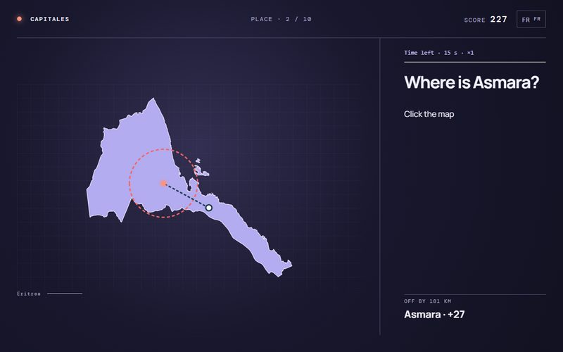

# Capitales — ChatGPT version

Name the city marked on the map or tap where a named capital belongs. Each expedition draws ten different countries from a catalogue of 195, with 15 seconds per question and a separate local top ten for each mode.

**[Play it in your browser](https://iago-swi.github.io/capitales/ChatGPT/)** · [What changed in each version](CHANGELOG.md)

| Name | Place |
| --- | --- |
|  |  |

## How to play

Select **Name** or **Place**, then press **Enter** or **Begin expedition**. Your mode and language choices are remembered.

- **Name:** identify the coral marker from four cities. Click a choice or press A–D or 1–4. A correct answer earns 100 points plus up to 100 for speed. Consecutive correct answers raise the multiplier by 0.25 to a maximum of ×2. A wrong answer or timeout breaks the streak.
- **Place:** click or tap once to place the named capital. The dashed red ring marks the target during the reveal. The first 25 km earn full accuracy. Points decrease to zero at twice the target radius, then fall as low as −100. On-target guesses earn the speed bonus and extend your streak. A timeout costs 100.
- **High scores:** a positive result qualifies if a slot is open or the score beats tenth place. Clear the selected mode’s list from its leaderboard.

## Downloads and local use

Published versions and available files are on the [GitHub Releases page](https://github.com/iago-swi/capitales/releases?q=chatgpt). Source archives are attached automatically by GitHub. The browser build is available as a ZIP.

To run the browser edition locally:

```powershell
npm install
npm run dev
```

To open the Electron desktop shell during development:

```powershell
npm run dev:windows
```

The project also defines `build:windows`, `build:linux`, and `build:linux:archive` scripts. See the [full project guide](PROJECT_GUIDE.md) for packaging instructions and database locations.

## Technical notes

### Stack

| Area | Technology | Responsibility |
| --- | --- | --- |
| Language and UI | TypeScript and React | Screens, state, answer flow and player interaction |
| Build | Vite | Development server and browser production bundle |
| Maps | D3 Geo, TopoJSON Client and `world-atlas` | Country geometry, fitted projection and capital coordinates |
| Storage | SQLite through `sql.js` WebAssembly | Local top-ten scores in browsers and desktop builds |
| Desktop | Electron and electron-builder | Windows and Linux shells and packages |
| Tests | Vitest | Country catalogue and question-generation rules |

### Files and folders

| Path | Responsibility |
| --- | --- |
| `src/App.tsx` | Welcome, quiz, name entry and leaderboard screens; ten-round flow and scoring |
| `src/CountryMap.tsx` | Draws the fitted SVG, handles pointer input and displays placement feedback |
| `src/countries.json` | 195 country records with map ID, names, capital, coordinates and region |
| `src/game.ts` | Chooses a country, prefers same-region distractors and shuffles four unique answers |
| `src/database.ts` | Creates, migrates, reads and persists the SQLite high-score table |
| `src/i18n.ts` | English and French interface copy plus localized country and capital names |
| `src/styles.css` | Visual design, responsive layouts and reduced-motion behavior |
| `electron/` | Desktop window and the restricted database load/save bridge |
| `PROJECT_GUIDE.md` | Database paths, schema, packaging, localization and extension guide |

### Geography, rules and persistence

`src/mapFrame.ts` rotates a Mercator projection around the capital’s longitude and fits the local landmass and nearby islands. This keeps remote territories from overwhelming the map and moves the projection seam away from the capital. The same projection draws the SVG, inverts pointer positions and draws the geographic target circle.

`src/scoring.ts` uses haversine distance with a 6,371 km Earth radius. The farthest of the four frame corners sets the reach. The target is 15% of reach with a 25 km minimum, including on microstate maps. Points are rounded once for each question. A game total may be negative.

`src/database.ts` creates a separate SQLite table for points and mode. Existing scores out of ten stay in the original table. Browser storage uses Base64 database bytes under `capitales.sqlite.base64`. Desktop editions save the same database to a file. See the [project guide](PROJECT_GUIDE.md) for locations and packaging.

### Testing

Run `npm test` and `npm run build`. Tests cover scoring examples, streaks, signs, leaderboard cutoffs, question selection and map projection for every capital. The Chromium check in `tools/check-game.cjs` exercises complete games, migration, touch input and separate rankings. Native Windows and Linux packages and physical touch devices were outside this release’s test run.
