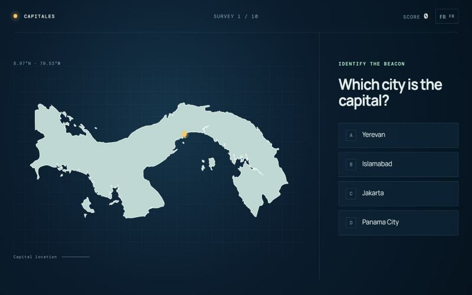

# Capitales — ChatGPT version

A world-capitals map quiz built with ChatGPT. Each question shows a country's outline and the exact location of its capital; choose the city from four answers. A game has ten questions, covers a catalogue of 195 countries, and can be played in English or French.

**[Play it in your browser](https://iago-swi.github.io/capitales/ChatGPT/)** · [What changed in each version](CHANGELOG.md)



## How to play

1. Select **Begin expedition**.
2. Study the country outline and the amber marker showing its capital.
3. Choose one of the four city names.
4. Continue through all ten questions. Each correct answer adds one point.
5. If the result reaches the local top ten, enter a name to save it.

The flag button switches between English and French at any time. **High scores** opens the ten best results stored for this edition in the current browser or desktop profile.

## Downloads and local use

Published versions and available files are on the [GitHub Releases page](https://github.com/iago-swi/capitales/releases?q=chatgpt). Source archives are attached automatically by GitHub. No Windows or Linux package was produced for version 1.0.1.

To run the browser edition locally:

```powershell
npm install
npm run dev
```

To open the Electron desktop shell during development:

```powershell
npm run dev:windows
```

The project also defines `build:windows`, `build:linux`, and `build:linux:archive` scripts. See the [full project guide](PROJECT_GUIDE.md) for packaging instructions and database locations.

## Technical notes

### Stack

| Area | Technology | Responsibility |
| --- | --- | --- |
| Language and UI | TypeScript and React | Screens, state, answer flow and player interaction |
| Build | Vite | Development server and browser production bundle |
| Maps | D3 Geo, TopoJSON Client and `world-atlas` | Country geometry, fitted projection and capital coordinates |
| Storage | SQLite through `sql.js` WebAssembly | Local top-ten scores in browsers and desktop builds |
| Desktop | Electron and electron-builder | Windows and Linux shells and packages |
| Tests | Vitest | Country catalogue and question-generation rules |

### Files and folders

| Path | Responsibility |
| --- | --- |
| `src/App.tsx` | Welcome, quiz, name entry and leaderboard screens; ten-round flow and scoring |
| `src/CountryMap.tsx` | Converts a country from TopoJSON, fits it into the SVG and projects the capital marker |
| `src/countries.json` | 195 country records with map ID, names, capital, coordinates and region |
| `src/game.ts` | Chooses a country, prefers same-region distractors and shuffles four unique answers |
| `src/database.ts` | Creates, migrates, reads and persists the SQLite high-score table |
| `src/i18n.ts` | English and French interface copy plus localized country and capital names |
| `src/styles.css` | Visual design, responsive layouts and reduced-motion behavior |
| `electron/` | Desktop window and the restricted database load/save bridge |
| `PROJECT_GUIDE.md` | Database paths, schema, packaging, localization and extension guide |

### Country data and map drawing

`countries.json` contains 195 records. Each numeric ID matches a geometry in `world-atlas/countries-10m.json`. `CountryMap.tsx` converts the selected TopoJSON geometry to GeoJSON, uses a Mercator projection to fit it inside an 800 × 480 SVG, then passes the same projection the capital's longitude and latitude. The outline and marker therefore use one coordinate system.

### Questions and scoring

`createQuestion` excludes the country used by the previous question. It starts the distractor pool with other countries from the same region, fills any remaining places from other regions, and shuffles the correct capital with three distractors. A correct answer is worth one point. The choices lock after the first selection, and a game ends after ten questions.

### Score storage

`sql.js` runs SQLite in WebAssembly. The browser exports the database as bytes, encodes them as Base64 and stores them under `capitales.sqlite.base64` in `localStorage`. This keeps all names and scores on the device and makes storage specific to the exact browser origin. Electron writes the same serialized database to `capitales.sqlite` in its user-data directory. Only the ten highest scores are retained; earlier scores win ties.

### Browser and desktop builds

`npm run build` type-checks the application and creates `dist/`. Vite uses relative asset paths, including the emitted `sql.js` WebAssembly file, so the build works from the `/capitales/ChatGPT/` GitHub Pages sub-folder. Electron loads that same build for packaged Windows and Linux editions and exposes only database load/save operations to the renderer.

### Testing

Run:

```powershell
npm test
npm run build
```

For version 1.0.1, the unit tests, production build, GitHub Pages sub-folder build, a complete ten-question browser game, score persistence after reload, desktop-width layout and approximately 390-pixel mobile layout were checked. Windows and Linux packages were not built or launched, and the game was not tested on a physical touch device. More implementation details and manual verification steps are in [PROJECT_GUIDE.md](PROJECT_GUIDE.md).
