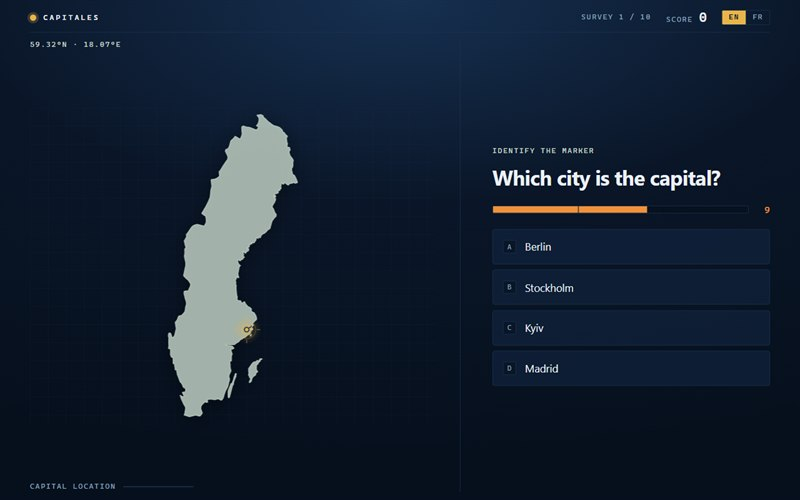
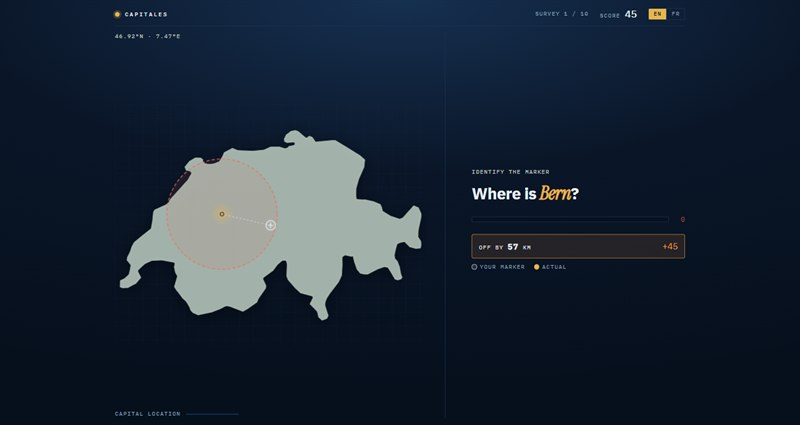

# Capitales — Claude version

A capital-cities quiz built with Claude (Anthropic), in English and French. Each
question shows one country's outline, drawn offline from Natural Earth data, and
there are two ways to answer: name the capital, or place it on the map.
193 countries, 15 seconds a question, ten questions a game, and a separate
top-ten list for each mode. Remake of a Visual Basic game from about 1996.

**[Play it in your browser](https://iago-swi.github.io/capitales/Claude/)** · [What changed in each version](CHANGELOG.md)

## Run it

Play online with the link above. Nothing is installed and nothing is sent anywhere:
the country data is inside the page, and scores are kept in your browser.

The same page is also a download: `index.html` from the
[latest release](https://github.com/iago-swi/capitales/releases/tag/claude-v1.0.3),
about 875 KB. Double-click it and it opens in the browser you already have, offline.
The online game and a downloaded copy keep separate scores, because a browser
stores data per address.

## How to play

**Name** — the marker is on the capital; pick the right city out of four.

**Place** — the city is named; click or tap the map where you think it is.

| | Name | Place |
| --- | --- | --- |
| Answer | Click a city, or press `A` to `D` or `1` to `4` | Click or tap the map |
| Points | 100, plus up to 100 for speed | Up to 200, falling with the distance |
| Streak | Every correct answer in a row raises the multiplier: ×1, ×1.25, ×1.5, ×1.75, then ×2 | The same, for answers inside the target |

The four cities offered in **Name** come from the same continent where possible.
In **Place**, distance is measured against the size of the map on screen, so being
57 km out in Switzerland is not scored like 57 km out in Canada. After each answer
a dashed red circle shows the target zone. A marker well outside it costs points,
so guessing the middle of the map does not pay.

`Enter` starts a game. The `EN | FR` switch changes the language and the
`NAME | PLACE` switch the mode; both are remembered. A score that makes the top
ten asks for a name. **High scores** at the bottom of the title screen shows the
list for the selected mode, and can clear it.

## Downloads

Every [release](https://github.com/iago-swi/capitales/releases?q=claude) has
these files:

| File | For |
| --- | --- |
| `index.html` | Any browser: the whole game in one file, offline |
| `Capitales-x.y.z-setup.exe` | Windows, with installation |
| `Capitales-x.y.z-portable.exe` | Windows, no installation |
| `Capitales-x.y.z-x64.tar.gz` | Linux x64: unpack and run `./capitales` |
| `Capitales-x.y.z.apk` | Android, installed from the file (debug-signed) |

Release 1.0.3 has the `index.html` only; the desktop and Android builds of
[release 1.0.2](https://github.com/iago-swi/capitales/releases/tag/claude-v1.0.2)
play the same game.

## Technical notes

The long documents are [PROJECT.md](PROJECT.md) (English) and
[PROJET.md](PROJET.md) (French): every script, the data pipeline and its traps,
the three versions of the placement scoring, and the packaging of each build.
This section is the overview.

### Stack

| | |
| --- | --- |
| Language | TypeScript, about 5,000 lines in the app and the packages, plus tests. |
| Interface | Svelte 5 and Tailwind CSS 4, built with Vite 8. |
| Maps | `d3-geo` (azimuthal equal-area projection) and `topojson-client`, drawn as inline SVG. |
| Data | Natural Earth 50m: 193 countries with their capitals in English and French, committed as JSON and TopoJSON. |
| Storage | Browser and Android: `localStorage`. Desktop: SQLite through Node's built-in `node:sqlite`, behind a small JSON API that runs inside the app. |
| Builds | One self-contained HTML file (`vite-plugin-singlefile`), Electron 43 for Windows and Linux, Capacitor 8 for Android. |
| Tests | Vitest: 240 tests, one `npm test`, nothing to start first. |

### Files and folders

| Path | Responsible for |
| --- | --- |
| `packages/core/` | The game itself, in pure TypeScript with no browser and no server: questions, scoring, the state machine, the top-ten rule, English and French texts, a seeded random generator. |
| `packages/geo/` | Turning a country's TopoJSON into an SVG outline and a pixel position for its capital. |
| `packages/data/` | The Natural Earth extraction (`build-data`), its two committed outputs, and the client that fetches them from the API. |
| `packages/data-local/` | The same three functions as `packages/data`, served from the bundle and `localStorage` instead of the API. |
| `packages/ui/` | Svelte components: the map, the timer, the answer buttons, the scoreboard, the switches, the wordmark, the credits. |
| `apps/web/` | The app: the screens, the keyboard, and how everything is put together. |
| `apps/single/` | The one-file build of `apps/web`, played online and offered as `index.html`. |
| `apps/server/` | The SQLite database and the JSON API (the only code that writes SQL). |
| `apps/desktop/` | The Electron shell for Windows and Linux, which runs the API in its own process. |
| `apps/android/` | The Capacitor configuration and the APK build script. |
| `version.ts` | Reads the version from `package.json` and gives it to the title screen and to the page's `<meta name="version">`. |
| `screenshot.jpg`, `docs/screenshots/` | The pictures in this README and on the landing page. |
| `docs/superpowers/` | The original design and implementation plan. |

### Country data

`npm run build:data` downloads Natural Earth 50m and writes
`packages/data/capitals.json` (193 countries) and `countries.topo.json`. It is the
only step that uses the network; both files are committed, so every build and
test runs offline. The 110m dataset was not enough: it leaves out 30 small
countries. `overrides.json` corrects what the source gets wrong and lists the
alternate capitals that are also accepted (South Africa, Bolivia, Côte d'Ivoire).

### Map drawing

For each question, `fitCountry` builds an azimuthal equal-area projection centred
on the country, fits it to the frame, and draws the outline and the capital with
that one projection, so they cannot drift apart. Equal-area keeps Canada and
Greenland from looking larger than they are. For a country whose territory is
spread across oceans, the frame shows the part around the capital. In **Place**,
the click goes back through the same projection to become a longitude and
latitude.

### Questions and scoring

Questions come from a seeded random generator, so a given seed always gives the
same ten countries in the same order, which is what makes the tests repeatable.
In **Name**, an answer scores `round((100 + speed) × multiplier)`, where speed
runs from about 100 for an instant answer down to 0 at the buzzer. In **Place**,
the target radius is 15% of the distance from the capital to the furthest corner
of the frame (at least 25 km); accuracy falls in a straight line to zero at twice
that radius, the speed bonus counts only inside the target, and a marker beyond
the zero ring loses up to 100 points. [PROJECT.md](PROJECT.md) sections 8 and 8b
give the formulas and how they were reached.

### Storage

The browser build keeps everything in `localStorage`: `capitales.runs.v1` (the
finished games, without the answer details), `capitales.lang` and
`capitales.mode`. Stored data that cannot be read is treated as empty, and a full
or disabled storage loses the score but never stops the game. The desktop builds
keep their games in a SQLite file in `%APPDATA%\Capitales` on Windows and
`~/.config/Capitales` on Linux.

### The builds

`apps/single` is `apps/web` with one alias changed: `@capitales/data` points to
`packages/data-local`, so no code that talks to a server reaches the bundle, and
every script, style and picture is inlined into one `index.html`. That file is
what GitHub Pages serves at `/Claude/`; it uses no absolute path, so it works from
a sub-folder, from a downloaded copy and from a `file://` address. The desktop app
bundles Chromium, which is why its installers are about 100 MB. The Android app is
the single file inside Capacitor. Section 14 of [PROJECT.md](PROJECT.md) covers
packaging, the JDK requirement for Android, and what is still unsigned.

### Testing

`npm run verify` runs the type check, the 240 tests and both web builds. The
builds are part of it on purpose: `tsc` does not read the script block of a
`.svelte` file, so the bundler is the only thing that type-checks the components.

| Area | What the tests cover |
| --- | --- |
| `core` | The random generator, question generation, both scoring rules, every state transition, both languages, the top-ten rule, the seven presses that open the credits |
| `geo` | Choosing the part of a country to show, fitting the projection, and a guard against swapped coordinates |
| `data` | The 193 countries: count, order, coordinate ranges, both languages, every override, and the match with the outlines; the API client |
| `ui` | The credits: every portrait is an image, no two people share a job, and the swipe rule |
| `server` | Every endpoint, malformed requests, the rule that a saved game cannot be changed, and clearing a list |

For version 1.0.3 the online build was checked from a `/Claude/` sub-folder on a
local server: a complete round in **Name** mode, the score still listed after a
reload, the version on the title screen, and no errors in the browser console.
Nothing in this round was tested on a real phone or on macOS, and the desktop and
Android builds were not rebuilt for 1.0.3.
