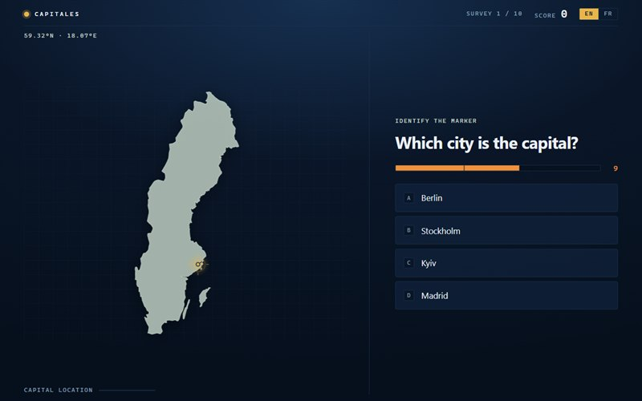
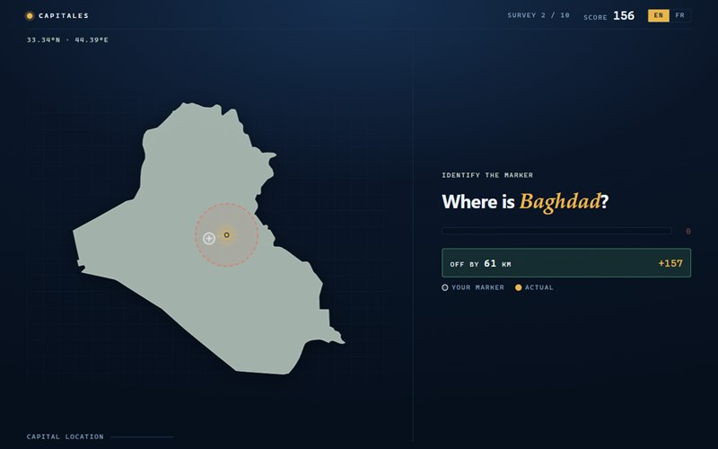
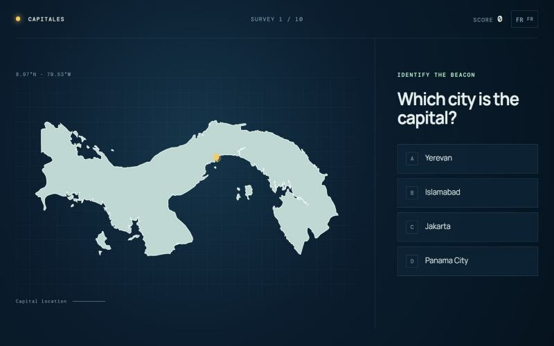

# Capitales

A capital-cities quiz, built in two versions to compare what different AI assistants produce. Each question shows one country's outline: name its capital, or place it on the map.

**Play it in your browser: <https://iago-swi.github.io/capitales/>**

| Version | Play | Download | Source and technical notes |
| --- | --- | --- | --- |
| Claude | [Play](https://iago-swi.github.io/capitales/Claude/) | [Releases](https://github.com/iago-swi/capitales/releases?q=claude) | [Claude/](Claude/) |
| ChatGPT | [Play](https://iago-swi.github.io/capitales/ChatGPT/) | [Releases](https://github.com/iago-swi/capitales/releases?q=chatgpt) | [ChatGPT/](ChatGPT/) |

The landing page links to every version that can be played online. Each version is self-contained in its own folder, with its own README.

## Claude version

Capitales in two modes, in English and French, on 193 countries drawn offline from Natural Earth data. In **Name**, the marker is on the capital and you pick the city out of four. In **Place**, the city is named and you put the marker on the map; distance is measured against the size of the map on screen, so being 57 km out in Switzerland is not scored like 57 km out in Canada. Ten questions a game, 15 seconds each, streak multipliers, and a top ten for each mode, kept in the browser. It also comes as one offline HTML file and as Windows, Linux and Android apps. [Play the Claude version](https://iago-swi.github.io/capitales/Claude/) · [How to play and technical notes](Claude/README.md)

| Name | Place |
| --- | --- |
|  |  |

## ChatGPT version

The ChatGPT version asks ten multiple-choice questions from a catalogue of 195 countries. Each question fits the selected country's outline into the map and marks the capital in amber; choose the city from four answers, then try to reach the top ten stored in SQLite on the device. The interface switches between English and French. [Play the ChatGPT version](https://iago-swi.github.io/capitales/ChatGPT/) · [How to play and technical notes](ChatGPT/README.md)



## Background

Capitales is a remake of a Visual Basic game from about 1996. In the original, a marker sits on a country's capital and you pick the city from four; that is the **Name** mode of the Claude version.

## Versions and release notes

Each version has its own version number. Every change a player can notice is recorded in that version's changelog and published as a release with the same notes: [all releases](https://github.com/iago-swi/capitales/releases).

| Version | Changelog | Tags |
| --- | --- | --- |
| Claude | [Claude/CHANGELOG.md](Claude/CHANGELOG.md) | `claude-vX.Y.Z` |
| ChatGPT | [ChatGPT/CHANGELOG.md](ChatGPT/CHANGELOG.md) | `chatgpt-vX.Y.Z` |

[VERSIONING.md](VERSIONING.md) explains how a version is numbered and published.

## Repository structure

```text
capitales/
|-- Claude/        # version built with Claude
|-- ChatGPT/       # version built with ChatGPT
|-- .github/       # workflows: publish a release for each version tag, and the site on GitHub Pages
|-- index.html     # landing page, published at https://iago-swi.github.io/capitales/
|-- README.md
|-- VERSIONING.md  # how versions and release notes work
|-- AGENTS.md      # instructions for AI assistants
`-- CLAUDE.md      # points to AGENTS.md
```

The Git history of both former repositories (`capitales-claude` and `capitales-chatgpt`) was kept when they were merged into this repository.
