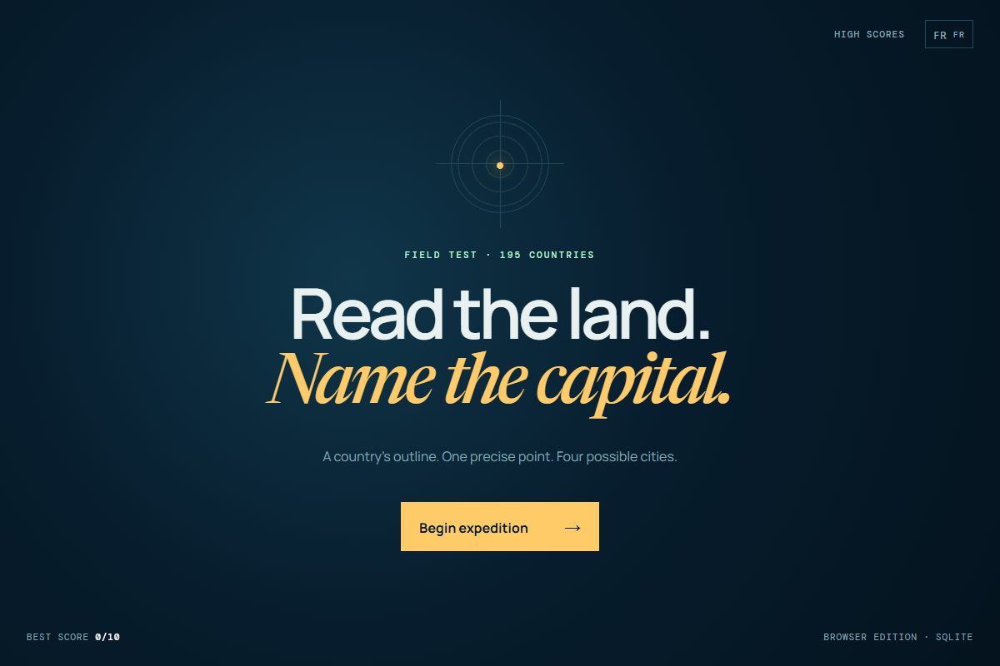

# Capitales

[Complete documentation in French](PROJECT_GUIDE_FR.md) · [Complete documentation in English](PROJECT_GUIDE.md)

A world-capitals quiz delivered as a browser game plus Windows and Linux desktop apps. All editions use SQLite through `sql.js`; the browser persists its database in local browser storage and desktop editions store `capitales.sqlite` in the user-data directory.



For architecture, database locations and schema, localization, packaging, testing, troubleshooting, and extension instructions, see the documentation links above.

## Run

```powershell
npm install
npm run dev
```

Open `http://localhost:5173` for the browser edition.

```powershell
npm run dev:windows
```

This opens the same game in its Windows shell.

Build the Linux AppImage and portable archive with:

```powershell
npm run build:linux
```

When cross-building from Windows, create the portable Linux archive with:

```powershell
npm run build:linux:archive
```

## Build

```powershell
npm run build
npm run build:windows
npm run build:linux
npm run build:linux:archive
```

Windows and Linux packages are written to `release/`.
